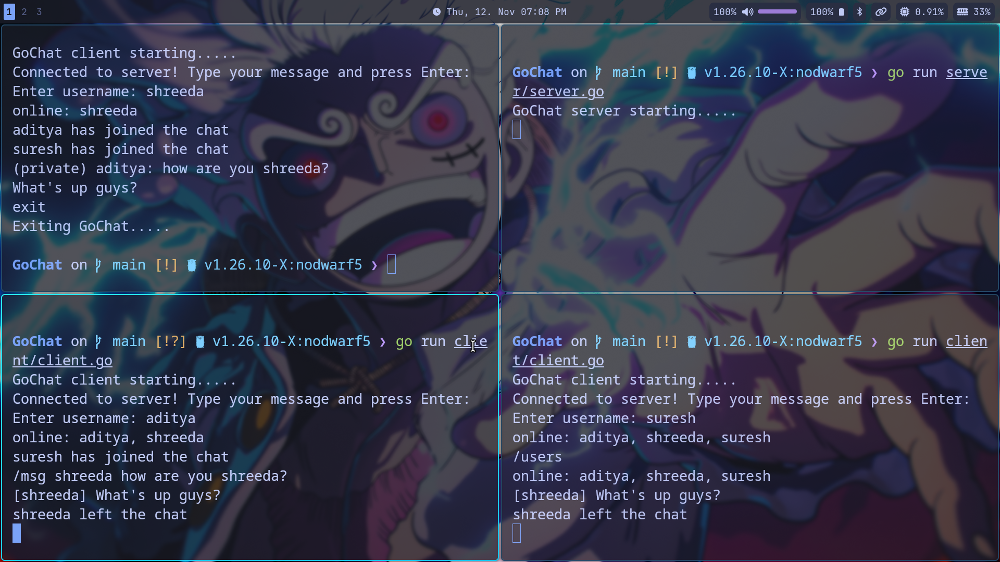

# GoChat

A concurrent TCP chat server and client written in Go, with public
broadcast, private messaging, and join/leave notifications.



## Features

- Multiple simultaneous clients (one goroutine per connection)
- Unique usernames, chosen when connecting
- Join and leave notifications
- Public messages broadcast to everyone else
- Private messages with `/msg`
- List of online users with `/users`
- Graceful disconnect with `exit` or `quit`

## Requirements

- Go 1.21 or newer (check with `go version`)

## Build

Run these from the project root:

```
go build -o ./build/server ./server
go build -o ./build/client ./client
```

Or skip building and use `go run ./server` and `go run ./client`.

## Run

1. Start the server in one terminal:

   ```
   ./build/server
   ```

2. Start each client in its own terminal:

   ```
   ./build/client
   ```

3. Enter a username when prompted, then start chatting.

The server listens on `127.0.0.1:8080` (the `addr` constant in
`server/server.go`), and the client connects to the same address,
so all clients must run on the same machine unless you edit both.

## Commands

| Input                       | Effect                       |
| --------------------------- | ---------------------------- |
| `hello everyone`            | Broadcast to all other users |
| `/msg <username> <message>` | Private message to one user  |
| `/users`                    | List online users            |
| `exit` or `quit`            | Disconnect                   |

## Design

- **Hub** holds a `map[string]*Client` protected by a `sync.Mutex`.
  Every access to the map, and every send to a client, happens under the lock.
- **Per client, two goroutines:** one reads lines from the socket
  (`handleOneClient`), and one writes to it (`Drain`), fed by a buffered
  `chan string`. Only `Drain` writes to the connection after login,
  so output lines never interleave.
- **Non-blocking delivery:** if a client's channel buffer (16 messages) is full,
  new messages for that client are dropped so one slow client cannot stall the others.
- **Protocol:** newline-terminated text. The server parses the line
  (`/msg`, `/users`, or a public message).

## Limitations

- No authentication or encryption (plaintext TCP).
- Address is hardcoded to localhost.
- Messages to a stalled client are dropped silently.
- Lines longer than 64 KB disconnect the sender.
